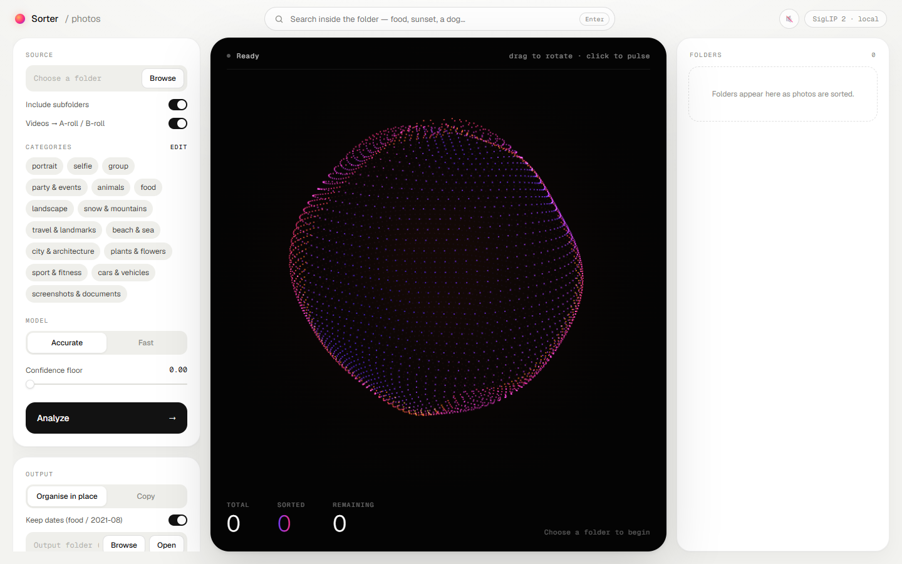
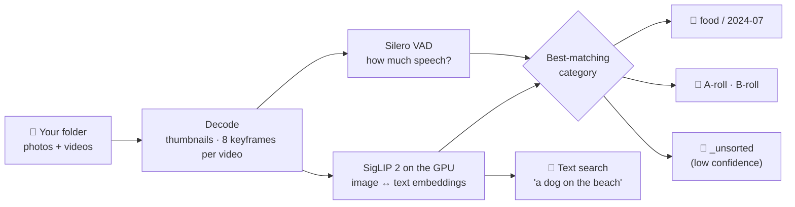

# Sorter

**A local, AI-powered photo & video sorter for Windows.** Drop a messy camera-roll folder on it and Sorter files every photo and clip into category folders (food, travel, portrait, beach & sea…) by what is actually *in* the picture. It also lets you search your folder in plain words, like *"a man in a white t-shirt"*. Everything runs on your own PC, and nothing is uploaded.



## Features

- **Sort by content.** Zero-shot image classification with Google **SigLIP 2** puts each file in its best-matching category. 17 categories come built in, and you can write your own as `folder name: what it looks like`, in any language.
- **Search inside the folder** (Ctrl+F). Free-text search over every photo and every sampled video moment. Video hits jump to the matching second and play in the app.
- **Videos → A-roll / B-roll.** Speech detection (Silero VAD) separates talking-head clips from B-roll, and B-roll is sub-sorted by category.
- **Keep dates.** Optional `category/YYYY-MM` folders, taken from EXIF, video metadata or the folder name. File-system dates are never used.
- **Duplicate finder.** Byte-identical copies are pre-selected for the Recycle Bin, and look-alike shots are flagged but never auto-ticked.
- **Safe moves with full Undo.** Every run is logged (`_sort_log.json`), so Undo can walk back to the original layout. Locked files (OneDrive and similar) are skipped, never half-copied.
- **Review sheet.** Least-confident files come first. Drag them onto a category or press 1–9, and your fixes are remembered for that folder.
- **Photographer-friendly.** Handles HEIC and RAW (Fuji RAF follows its JPG), and `.AAE` / `.XMP` sidecars travel with their photo.
- **Fast on re-runs.** Thumbnails, frames and embeddings are cached. A second pass over 423 files took 0.3 s instead of 14 s.
- **Polished UI.** An interactive particle sphere (drag, hover, click) that files fly out of, plus an animated launch intro with live-synthesised sound.

## Download & run (Windows)

[](https://github.com/gameirow/photo-sorter/releases/latest/download/Sorter.zip)

1. Install **[Python 3.12](https://www.python.org/downloads/)** and tick **"Add python.exe to PATH"**.
2. Download **[Sorter.zip](https://github.com/gameirow/photo-sorter/releases/latest/download/Sorter.zip)** and unzip it anywhere.
3. Double-click **`run.bat`**.

The first launch takes a few minutes: it sets up its own environment (PyTorch with CUDA, falling back to CPU) and puts a **Sorter** shortcut on your desktop. After that, it opens in seconds. The AI model downloads once, on first use. An NVIDIA GPU is recommended; without one it runs on the CPU, just more slowly.

<details>
<summary>Developers: run from source</summary>

```bash
git clone https://github.com/gameirow/photo-sorter.git
cd photo-sorter

```bash
python -m venv .venv
.venv\Scripts\pip install torch --index-url https://download.pytorch.org/whl/cu128
.venv\Scripts\pip install -r requirements.txt
.venv\Scripts\python photo_sorter.py
```

Without `pywebview`, it opens in your default browser instead of its own window.

</details>

## Using it in 3 steps

1. **Drop a folder** onto the window (or click *Browse*).
2. **Analyze.** Files fly out of the sphere into category cards as they are classified.
3. **Review & organise.** Fix any low-confidence picks, then click *Organise in place*. *Undo* puts everything back.

## How it works



Each category is just a sentence ("food: a photo of a meal or dish"). SigLIP compares every image with every sentence, and the closest one wins, so no training is needed.

| Piece | What it does |
|---|---|
| `photo_sorter.py` | Launcher + engine: a FastAPI server on a random localhost port, the SigLIP 2 classifier, video keyframe sampling (PyAV), speech detection, file moves, undo and caches |
| `ui.html` | The single-page interface, shown in a native window via pywebview (Edge WebView2) |
| `splash.html` | The launch intro, played while PyTorch loads in the background |
| `run.bat` | One-click setup + launcher |

- **Confidence** is a softmax over the categories. Anything under the *Confidence floor* goes to `_unsorted`.
- **Videos** are sampled at 8 keyframes, which are averaged for sorting and kept per frame for search.
- **Pipeline:** files decode in a thread pool while the model loads, then the GPU classifies them in batches of 16.
- **Caches** live in `%TEMP%/photo_sorter_thumbs/`.

## Tech

Python · FastAPI · Uvicorn · PyTorch · Hugging Face Transformers (SigLIP 2) · Silero VAD · PyAV · Pillow (+ HEIF, rawpy) · pywebview · vanilla HTML/CSS/JS (Canvas) · Web Audio
